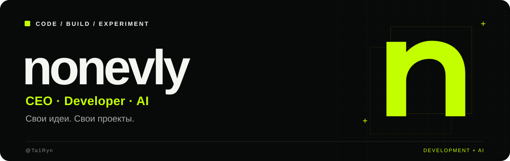
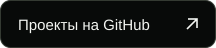
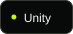
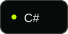
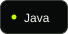
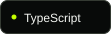
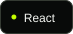
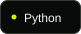
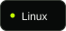
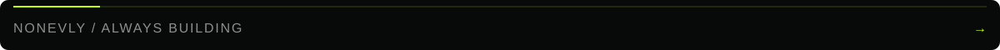

  
  
  

## Привет, я nonevly.

Разработчик. Создаю свои проекты и использую ИИ в работе.

Исследую разные направления разработки. Мне интересны новые технологии, эксперименты и идеи, которые можно превратить в работающий продукт.

## Инструменты

  
  
  
  
  
  
  
  

## Связаться

[Telegram — @nonevly](https://t.me/nonevly) · Discord — **nonek1d**

